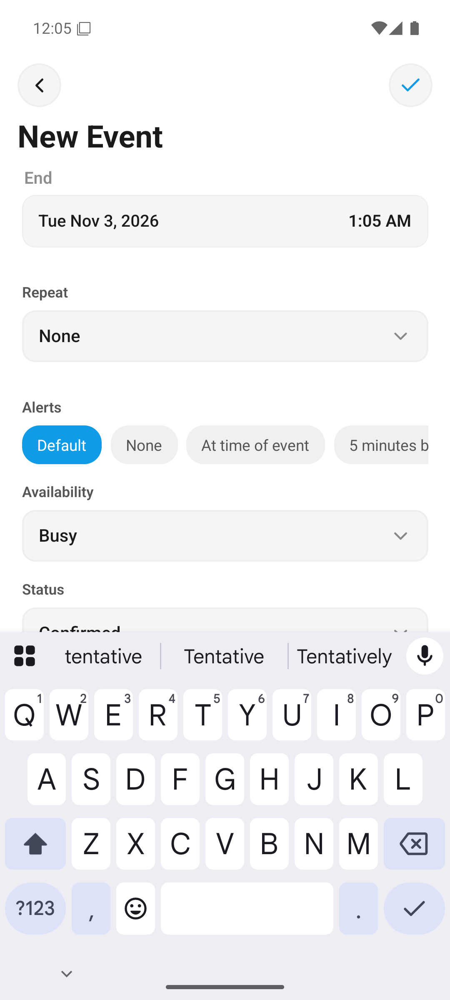
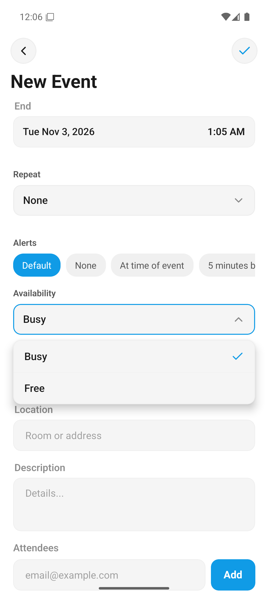
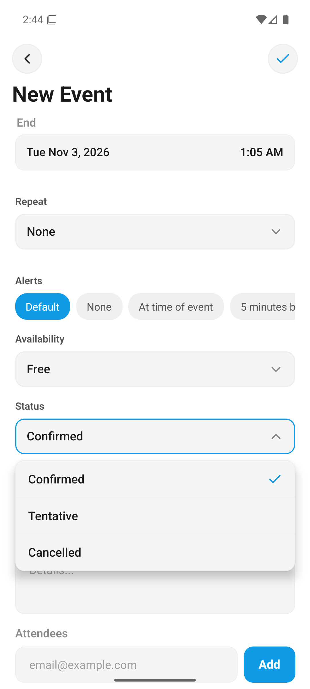
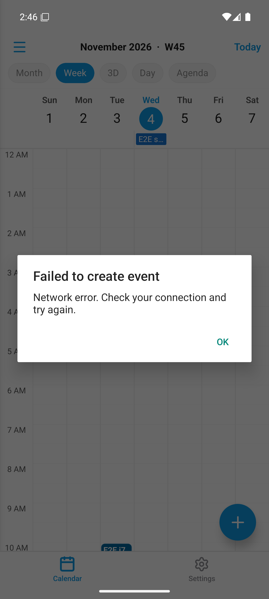

# Disponibilité et statut d'un événement (PR #4 / #377)

Cette fonctionnalité ajoute deux champs au formulaire d'événement, conformes à RFC 5545 :

- **Disponibilité** (`TRANSP`) : *Occupé* (défaut) ou *Libre* — indique aux autres si votre temps est bloqué, même si l'événement existe.
- **Statut** (`STATUS`) : *Confirmé* (défaut), *Provisoire* ou *Annulé* — le cycle de vie de l'événement.

## Créer un événement avec disponibilité/statut

1. Touchez le bouton **+** (écran Calendrier) pour ouvrir le formulaire.
2. Saisissez le titre, la date, etc.
3. Faites défiler jusqu'aux deux nouveaux sélecteurs **Disponibilité** et **Statut**
   
4. Ouvrez **Disponibilité** et choisissez *Libre* (ex. un rendez-vous personnel qui ne bloque pas)
   
5. Ouvrez **Statut** et choisissez *Provisoire* (ex. invitation non confirmée)
   
6. **Enregistrez**.

## Rendu dans l'application

- L'écran **détail** de l'événement affiche les valeurs non-par-défaut
  
- Dans l'**agenda** : un événement *provisoire* s'affiche en *italique*, un événement *annulé* est **barré** et atténué (captures existantes `04-agenda-tentative-italic.png`, `07-agenda-tentative-vs-cancelled.png`).
- À l'édition, les pickers sont pré-remplis avec les valeurs de l'événement ; ils sont désactivés sur les calendriers en lecture seule.

## Côté CalDAV / Nextcloud

- Les valeurs sont écrites dans l'ICS (`TRANSP:TRANSPARENT`, `STATUS:TENTATIVE`, `STATUS:CANCELLED`) — visibles dans l'app Calendrier web Nextcloud.
- Les valeurs par défaut RFC (occupé/confirmé) ne sont **pas** émises → pas de pollution `STATUS:CONFIRMED`.
- Un événement récurrent peut annuler une seule occurrence (`RECURRENCE-ID` + `STATUS:CANCELLED`).
