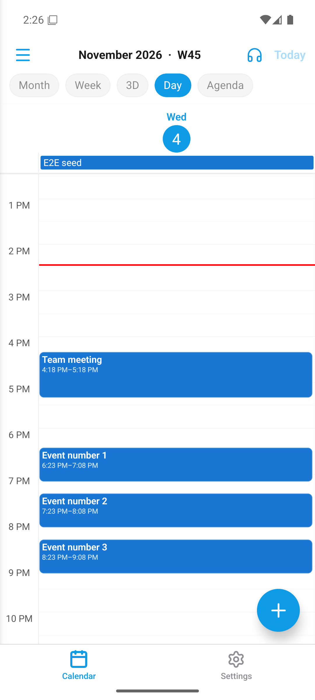
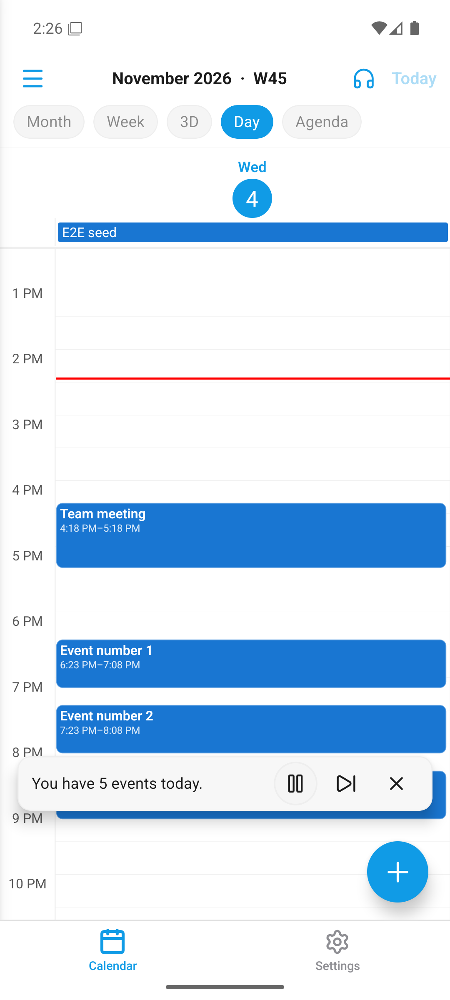
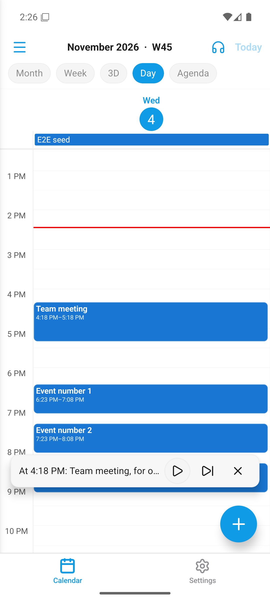
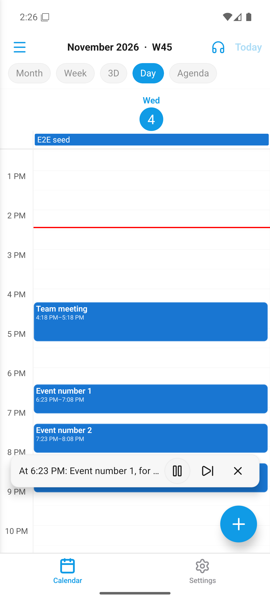

# Écouter ma journée — guide utilisateur (PR #3)

L'application peut désormais **lire à voix haute le programme de votre journée** —
un « briefing audio » 100 % local : aucune donnée ne quitte l'appareil et la fonction
marche même hors ligne.

## Démarrer le briefing

1. Ouvrez l'onglet **Calendrier**.
2. Dans la barre du haut, touchez l'icône **🎧 (casque)** — c'est le bouton
   « Écouter ma journée ».

   

3. Une **mini-barre de lecture** apparaît en bas de l'écran et la lecture commence :
   l'application énonce les événements du jour affiché, dans l'ordre —
   par exemple *« À 16 h 18 : Team meeting, pendant une heure, Room Atlas »*.

   

## Contrôler la lecture

La barre affiche le segment en cours de lecture et trois boutons :

| Bouton | Action |
|---|---|
| **⏸ / ▶** (grand, à gauche) | **Pause / Reprendre**. Sur Android, la pause arrête la phrase en cours ; « Reprendre » la relit depuis le début. |
| **⏭** | **Événement suivant** — saute directement au segment suivant. |
| **✕** | **Arrêter** le briefing et fermer la barre. |

## Ce que dit le briefing

- Les événements du **jour affiché** (pas seulement « aujourd'hui » : naviguez vers un
  autre jour puis touchez 🎧 pour écouter ce jour-là).
- Pour chaque événement : **l'heure, le titre, la durée, le lieu** (et le nom des
  premiers participants le cas échéant).
- Les événements « toute la journée » sont annoncés comme tels.
- **Les descriptions ne sont jamais lues** — leur contenu reste privé.
- Les événements déjà terminés sont ignorés quand vous écoutez le jour en cours.
- Si le jour est vide, un message vocal l'indique (« Aucun événement aujourd'hui »).

## Autres points d'entrée

- **Widget d'accueil** : le bouton « Écouter » du widget ouvre l'application et lance
  le briefing automatiquement.
- **Notifications de rappel** : une action « Écouter » sur les rappels d'événements
  lit le rappel et les événements qui suivent ; une action « Itinéraire » est aussi
  disponible.

## Bon à savoir

- La voix suit la **langue de l'application** (le briefing est généré dans votre langue).
- La lecture **s'arrête automatiquement** si vous quittez l'application.
- Fonctionne **hors connexion** : tout est calculé sur l'appareil.
- Calendriers masqués : leurs événements ne sont pas lus.
